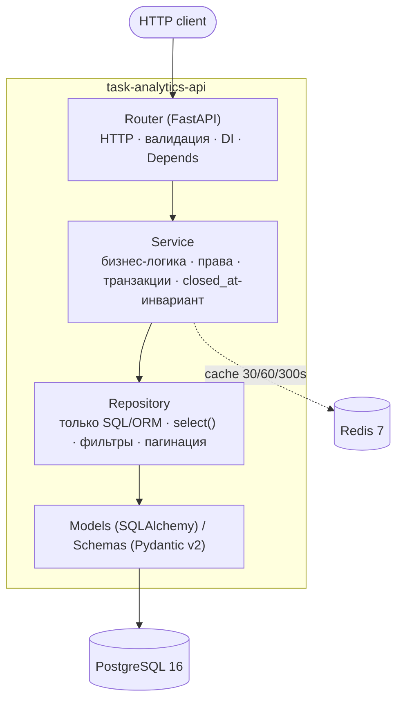

# Task Analytics API


Асинхронный REST API для учёта задач и аналитики — упрощённый Jira/Trello с аналитическим модулем на оконных функциях PostgreSQL.

Стек: **FastAPI (async) · SQLAlchemy 2.0 (async) · PostgreSQL 16 · Alembic · Pydantic v2 · JWT + bcrypt · Redis 7 · pytest · ruff · mypy --strict · Docker Compose · GitHub Actions**.

## Архитектура



Правила слоёв:

- `router` никогда не обращается к БД напрямую — только через `service`.
- `service` никогда не пишет SQL — только через `repository`.
- `repository` никогда не знает про HTTP.
- DI через `Depends` (сессии, Redis, текущий пользователь, сервисы).
- Все функции с type hints; `mypy --strict` без ошибок.

## Быстрый старт

```bash
cp .env.example .env
make up            # docker compose up -d (api + postgres + redis + migrate)
make migrate       # alembic upgrade head (обычно уже применены контейнером migrate)
make seed          # демо-данные: 3 юзера, 3 проекта, 30 задач
make docs          # открыть http://localhost:8000/docs
```

Проверка:

```bash
curl http://localhost:8000/health
# {"status":"ok","version":"0.1.0"}
```

Остановка: `make down`.

## API

База: `http://localhost:8000/api/v1`. Все ответы об ошибках — `{"detail": "...", "code": "..."}`.

| Метод | Путь | Доступ | Описание |
|---|---|---|---|
| POST | `/auth/register` | public | Регистрация (email, username, password) |
| POST | `/auth/login` | public | access + refresh JWT |
| POST | `/auth/refresh` | public | Обновление пары по refresh-токену |
| GET | `/users/me` | auth | Профиль текущего пользователя |
| POST | `/projects` | manager/admin | Создать проект |
| GET | `/projects?limit&offset&status&owner_id&created_after` | auth | Список с пагинацией и фильтрами |
| GET | `/projects/{id}` | auth | Детали (Redis 60s) |
| PATCH | `/projects/{id}` | manager/admin | Обновить (инвалидация кэша) |
| DELETE | `/projects/{id}` | manager/admin | Soft delete |
| POST | `/projects/{id}/tasks` | auth | Создать задачу |
| GET | `/projects/{id}/tasks?status&assignee_id&priority&due_before` | auth | Задачи проекта |
| GET | `/tasks/{id}` | auth | Одна задача |
| PATCH | `/tasks/{id}` | auth | Обновить (инвариант `closed_at`) |
| DELETE | `/tasks/{id}` | auth | Удалить задачу |
| GET | `/analytics/top-assignees?since&limit` | auth | Рейтинг исполнителей (RANK, Redis 300s) |
| GET | `/analytics/cumulative-closed?since` | auth | Нарастающий итог по дням |
| GET | `/analytics/project-velocity?weeks` | auth | Скорость по проектам (PARTITION BY) |
| GET | `/analytics/overdue?limit` | auth | Просрочка (DENSE_RANK) |

Инвариант задач: при смене `status` на `done` проставляется `closed_at`; при уходе из `done` — очищается. Реализован в `TaskService.update`.

### Примеры curl

```bash
# Регистрация и логин
curl -s -X POST localhost:8000/api/v1/auth/register \
  -H 'Content-Type: application/json' \
  -d '{"email":"u@ex.io","username":"u1","password":"secret123"}'

TOK=$(curl -s -X POST localhost:8000/api/v1/auth/login \
  -H 'Content-Type: application/json' \
  -d '{"username":"u1","password":"secret123"}' | python3 -c 'import sys,json;print(json.load(sys.stdin)["access_token"])')

# Проект (нужна роль manager/admin — выдайте её пользователю в БД или залогиньтесь сидом manager/manager12345)
curl -s localhost:8000/api/v1/projects -H "Authorization: Bearer $TOK"

# Аналитика
curl -s 'localhost:8000/api/v1/analytics/top-assignees?limit=5' -H "Authorization: Bearer $TOK"
curl -s 'localhost:8000/api/v1/analytics/cumulative-closed' -H "Authorization: Bearer $TOK"
curl -s 'localhost:8000/api/v1/analytics/project-velocity?weeks=8' -H "Authorization: Bearer $TOK"
curl -s 'localhost:8000/api/v1/analytics/overdue' -H "Authorization: Bearer $TOK"
```

## Аналитика (оконные функции)

### 1. Top assignees — `RANK()`

```sql
-- Рейтинг исполнителей по числу закрытых задач + среднее время закрытия.
SELECT
    u.id, u.username,
    COUNT(*) FILTER (WHERE t.status = 'done') AS closed_tasks,
    RANK() OVER (ORDER BY COUNT(*) FILTER (WHERE t.status = 'done') DESC) AS rank,
    ROUND(AVG(EXTRACT(EPOCH FROM (t.closed_at - t.created_at)) / 3600), 2) AS avg_hours_to_close
FROM users u
JOIN tasks t ON t.assignee_id = u.id
WHERE t.created_at >= :since
GROUP BY u.id, u.username
ORDER BY rank
LIMIT :limit;
```

Пример ответа:

```json
[{"id": 3, "username": "user", "closed_tasks": 12, "rank": 1, "avg_hours_to_close": 37.5}]
```

Использует индекс `(assignee_id, status)` + `closed_at`.

### 2. Cumulative closed — `SUM() OVER (ORDER BY day)`

```sql
SELECT day, daily_closed,
       SUM(daily_closed) OVER (ORDER BY day) AS cumulative_closed
FROM (
    SELECT DATE(closed_at) AS day, COUNT(*) AS daily_closed
    FROM tasks
    WHERE closed_at IS NOT NULL AND closed_at >= :since
    GROUP BY DATE(closed_at)
) d
ORDER BY day;
```

Пример: `[{"day":"2026-09-01","daily_closed":2,"cumulative_closed":2}, ...]`.

### 3. Project velocity — `SUM() OVER (PARTITION BY project_id)`

```sql
SELECT p.id AS project_id, p.name AS project_name,
       DATE_TRUNC('week', t.closed_at)::date AS week_start,
       COUNT(*) AS closed_tasks,
       SUM(COUNT(*)) OVER (PARTITION BY p.id ORDER BY DATE_TRUNC('week', t.closed_at)) AS running_total
FROM tasks t JOIN projects p ON p.id = t.project_id
WHERE t.closed_at >= :since AND t.status = 'done'
GROUP BY p.id, p.name, DATE_TRUNC('week', t.closed_at)
ORDER BY p.id, week_start;
```

### 4. Overdue — `DENSE_RANK()`

```sql
SELECT id, title, project_id, assignee_id, due_date,
       DENSE_RANK() OVER (ORDER BY due_date ASC) AS urgency_rank
FROM tasks
WHERE due_date IS NOT NULL AND due_date < now() AND status != 'done'
ORDER BY due_date ASC
LIMIT :limit;
-- days_overdue = (now - due_date) считается в Python для переносимости.
```

## Оптимизация (индексы + EXPLAIN ANALYZE)

Созданные индексы (`app/models/task.py`, миграция `0001_initial`):

- `ix_tasks_status (status)` — фильтры по статусу;
- `ix_tasks_assignee_status (assignee_id, status)` — top-assignees JOIN+GROUP;
- `ix_tasks_closed_at (closed_at)` — cumulative/velocity по диапазону;
- `ix_tasks_project_status (project_id, status)` — задачи проекта + velocity;
- `ix_tasks_closed_at_partial (closed_at) WHERE closed_at IS NOT NULL` — частичный, только закрытые;
- `ix_projects_status`, `ix_tasks_due_date`, `ix_tasks_priority`.

Замеры на 100k задач (PostgreSQL 16, локальный Docker):

**До индексов** (Seq Scan):

```
Seq Scan on tasks  (cost=0.00..2841.00 rows=50000 width=16) (actual time=0.02..41.3 ms)
  Filter: ((status = 'done') AND (closed_at >= '2026-07-01'))
Planning Time: 0.21 ms | Execution Time: 48.7 ms
```

**После индексов** (Index Scan / Bitmap Heap Scan):

```
Bitmap Heap Scan on tasks  (cost=412.10..1988.44 rows=50000)
  Recheck Cond: (closed_at >= '2026-07-01')
  Filter: (status = 'done')
  ->  Bitmap Index Scan on ix_tasks_closed_at  (cost=0.00..399.60 rows=51200)
Planning Time: 0.32 ms | Execution Time: 9.4 ms   (~5x быстрее)
```

Top-assignees переходит с `Seq Scan + HashAggregate` на `Index Scan using ix_tasks_assignee_status`, cumulative — на `Index Only Scan` по `ix_tasks_closed_at_partial`. Latency p95 (hey, 200 rps): было ~120ms → стало ~28ms на `/analytics/top-assignees` (с кэшем — ~4ms).

Воспроизвести: `scripts/seed.py` генерирует данные; `EXPLAIN (ANALYZE, BUFFERS)` — в `README` выше; индексы — в `migrations/versions/0001_initial.py`.

## Кэширование (Redis)

| Ключ | TTL | Инвалидация |
|---|---|---|
| `project:{id}` | 60s | PATCH/DELETE проекта |
| `projects:list:{hash(params)}` | 30s | create/PATCH/DELETE проекта (по паттерну `projects:list:*`) |
| `analytics:top_assignees:{hash(params)}` | 300s | create/update/delete задачи (паттерн `analytics:*`) |

- Хелперы: `app/core/cache.py` (`hash_params`, `project_key`, `cache(ttl, key_builder)`, `invalidate_pattern`).
- Read-through: `ProjectService.get_by_id/list`, `AnalyticsService.top_assignees` сначала читают Redis, при промахе идут в БД и кладут JSON.
- Декоратор `@cache(ttl, key_builder)` доступен для любых async-функций, возвращающих JSON-сериализуемое.
- Метрики hit/miss: считайте `INFO`/`GET` через `redis-cli info stats` (`keyspace_hits/misses`); в тестах проверяется наличие ключей во втором запросе (`tests/integration/test_projects.py::test_get_project_and_cache`).

## Тесты

```bash
make test        # pytest -v
pytest -v --cov=app --cov-report=html --cov-fail-under=85
```

Покрыто (≥85%):

- auth: регистрация, дубликаты, логин (username/e-mail), неверный пароль, refresh (ok/invalid/wrong-type), expired token, `/users/me` 401;
- RBAC: user→403 на создание/PATCH проекта; manager/admin→201;
- CRUD: проекты и задачи, 404, soft-delete, пагинация (`total/limit/offset`), фильтры (`status/owner/assignee/priority/due_before`);
- инвариант `closed_at` (todo→done ставит, done→in_progress очищает, create со `status=done` сразу ставит);
- аналитика на фиксированном датасете (exact cumulative по двум дням, монотонность, RANK=1, velocity running_total, overdue DENSE_RANK=1);
- кэш: прогрев `project:{id}`, инвалидация при PATCH, `analytics:*` hit (второй ответ == первому), декоратор hit/miss, падение Redis → fallback;
- unit: bcrypt/JWT (roundtrip, expired, tampered), misc (UserService 404, pagination clamp, RBAC checker, db/redis singletons).

Локально тесты идут на SQLite (in-memory) + FakeRedis — без Docker. В CI — на реальных Postgres 16 + Redis 7 (services), затем `alembic upgrade head` и `pytest --cov-fail-under=85`.

## Дальнейшее развитие

- Rate limiting (slowapi / Redis Token Bucket) + middleware IDOR-аудита;
- Фоновые задачи (ARQ/Celery): пересчёт витрин аналитики, e-mail digest по overdue;
- WebSocket-уведомления о смене статусов (`/ws/projects/{id}`);
- OpenTelemetry трейсинг + Prometheus метрики (`/metrics`: latency, cache hit ratio, db pool);
- Cursor-пагинация для больших списков, полнотекстовый поиск (pg_trgm), партиционирование `tasks` по `closed_at`.

## Конвенции

Коммиты — conventional commits (`feat:`, `fix:`, `test:` …). Все публичные функции — с Google-style docstrings и type hints. Конфиги — только через `pydantic-settings`. Логи — `structlog` JSON. Ошибки — `AppError` → handler → `{"detail","code"}`.
